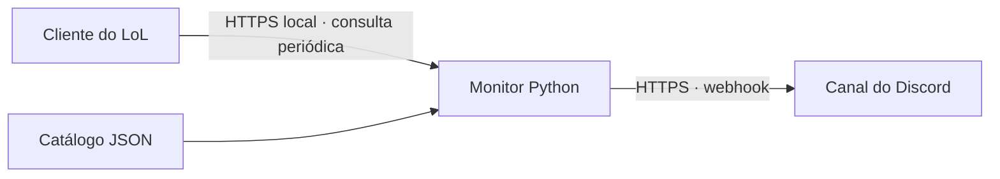

# Assistente de builds para League of Legends

## Sobre o projeto

Durante a entrada em uma partida, buscar os itens do campeão em outro site toma tempo. Este projeto acadêmico consulta a partida em andamento, encontra opções no catálogo e publica a recomendação em um canal do Discord.

## Arquitetura



O monitor identifica o jogador ativo no JSON da Riot e filtra o catálogo por campeão, rota e patch. A rota e o patch vêm da configuração. O relógio da partida ajuda a distinguir uma partida nova das consultas seguintes da mesma sessão. O estado fica em memória, então reiniciar o programa durante a partida pode gerar outro aviso.

O cliente fechado é tratado como estado de espera. Falhas de rede e respostas HTTP aparecem no terminal. Em caso de limitação do Discord (HTTP 429), o programa respeita o tempo informado pelo serviço e faz até três tentativas no total. Um timeout no envio fica registrado como entrega sem confirmação, pois reenviar poderia duplicar a mensagem.

## Tecnologias e APIs

- Python 3.11 ou superior, com biblioteca padrão para JSON, HTTP e TLS.
- [Riot Live Client Data API](https://developer.riotgames.com/docs/lol#live-client-data-api), disponível em `127.0.0.1:2999` enquanto o jogo está ativo.
- [Webhook do Discord](https://docs.discord.com/developers/resources/webhook), com token na própria URL.

## Passo a passo para rodar

Todos os comandos são para o **PowerShell**, abertos na pasta do projeto.

### 1. Instale o Python

Instale o [Python 3.11 ou superior](https://www.python.org/downloads/). No instalador, marque **"Add python.exe to PATH"**. Para confirmar:

```powershell
python --version
```

O projeto usa só a biblioteca padrão do Python, então **não precisa de `pip install`**.

### 2. Crie o arquivo `.env`

```powershell
Copy-Item .env.example .env
```

Abra o `.env` no editor. Cada linha do `.env.example` tem um comentário explicando o que vai nela. Nada é obrigatório para abrir o painel. Preencha só o que for usar:

| Variável | Para que serve | Obrigatória? |
|---|---|---|
| `RIOT_CA_FILE` | Certificado para conversar com o cliente do LoL (passo 3) | Só para acompanhar o draft ou a partida |
| `DISCORD_WEBHOOK_URL` | Canal do Discord que recebe a build (passo 4) | Só para enviar ao Discord |
| `BUILD_ROLE` / `BUILD_PATCH` | Rota e patch da build enviada pelo monitor | Já vêm preenchidas |
| `POLL_SECONDS` | Intervalo entre as consultas ao jogo | Já vem preenchida (5) |
| `LOL_LOCKFILE` | Caminho do lockfile do LoL, se o painel não achar o cliente sozinho | Não |
| `RIOT_API_KEY` | Chave para importar partidas da Riot (passo 5) | Não |

Use o formato `CHAVE=valor`, sem aspas. **Nunca envie o `.env` para o GitHub** (ele já está no `.gitignore`).

### 3. Baixe o certificado da Riot (para o draft e o monitor)

```powershell
Invoke-WebRequest https://static.developer.riotgames.com/docs/lol/riotgames.pem -OutFile riotgames.pem
```

O arquivo fica na pasta do projeto, que é o caminho já configurado em `RIOT_CA_FILE`.

### 4. Crie o webhook do Discord (opcional)

1. No Discord, abra as **Configurações do canal** (você precisa da permissão "Gerenciar webhooks").
2. Vá em **Integrações → Webhooks → Novo webhook**.
3. Clique em **Copiar URL do webhook** e cole em `DISCORD_WEBHOOK_URL` no `.env`.

### 5. Gere a chave da Riot (opcional)

Só é necessária para importar partidas com `winrates.py`. As taxas do OP.GG no painel funcionam sem ela.

1. Entre em [developer.riotgames.com](https://developer.riotgames.com) com sua conta da Riot.
2. Copie a **Development API Key** do painel e cole em `RIOT_API_KEY` no `.env`.
3. Essa chave expira a cada 24 horas. Quando expirar, clique em **Regenerate API Key** e atualize o `.env`.

### 6. Abra o painel

```powershell
python dashboard.py
```

Acesse <http://127.0.0.1:8765>. Para parar, pressione **Ctrl+C** no PowerShell. O painel precisa de internet para buscar os dados do OP.GG. Se a porta estiver ocupada, use `python dashboard.py --port 8080`.

## Passo a passo para testar

### Testes automáticos

```powershell
python -m unittest discover -s tests
```

O resultado esperado termina com `OK`. São 74 testes, que cobrem a leitura do OP.GG e a API do painel.

### Teste rápido sem o jogo (modo demo)

```powershell
python app.py --demo
```

O comando simula uma partida com a Annie e imprime duas opções de build no terminal. Não precisa de `.env`, do jogo nem do Discord.

Com o webhook configurado, este comando envia a mesma build simulada para o canal do Discord:

```powershell
python app.py --enviar-demo
```

### Teste do painel no navegador

1. Rode `python dashboard.py` e abra <http://127.0.0.1:8765>.
2. Na coluna **Campeões**, busque e clique num campeão, por exemplo a **Ahri**. Confira:
   - os botões de rota no topo, com a % de partidas em cada rota;
   - as taxas de vitória de Solo/Duo, Flex e ARAM;
   - enquanto o OP.GG carrega, a animação de carregamento; depois, as runas e a build;
   - Itens iniciais e Feitiços de invocador lado a lado no topo;
   - o Quarto, o Quinto e o Sexto item ordenados da maior para a menor taxa de vitória.
3. Clique num campeão de selva, por exemplo o **Lee Sin**, e confira o bloco **Rotas da selva**.
4. Na coluna **Inimigos**, clique num adversário e abra a aba **vs inimigo** para ver o confronto.

### Teste com o jogo aberto

1. Confirme que o `riotgames.pem` está na pasta (passo 3).
2. Com o painel rodando, abra o LoL e entre numa **seleção de campeões**, por exemplo numa Partida Personalizada. O painel mostra seu pick e os inimigos confirmados a cada 2 segundos.
3. Para o monitor do Discord, rode `python app.py` e entre numa partida da **Ferramenta de Treino** com a Annie. A build chega ao canal. Pressione Ctrl+C para encerrar.

### Problemas comuns

| Sintoma | O que fazer |
|---|---|
| `python` não é reconhecido | Reinstale o Python marcando "Add python.exe to PATH" e abra um novo PowerShell. |
| `Linha N do .env inválida` | Essa linha do `.env` não está no formato `CHAVE=valor`. |
| O painel não detecta o draft | Confira o `riotgames.pem`. Se o LoL estiver instalado fora do padrão, preencha `LOL_LOCKFILE`. |
| As taxas do OP.GG não aparecem | Confira a internet e recarregue a página. Sem o OP.GG, as rotas vêm da cópia local em `data/roles.json`. |
| `winrates.py` dá erro 401 ou 403 | A `RIOT_API_KEY` expirou. Gere outra no portal da Riot. |

## Detalhes do funcionamento

O monitor de partidas (`python app.py`) consulta o jogo a cada `POLL_SECONDS` segundos. `BUILD_ROLE` e `BUILD_PATCH` precisam bater com o catálogo. As opções incluídas são referências iniciais marcadas como `geral`: Annie e Ahri em `mid` e Garen em `top`. Para manter uma build por versão, informe o mesmo patch em `data/builds.json` e no `.env`. Variáveis de ambiente do sistema têm prioridade sobre o `.env`.

### Painel local

Execute `python dashboard.py` e acesse [Rift Builds](http://127.0.0.1:8765). O painel lista todos os campeões do catálogo local da Riot, oferece um link de builds e runas para campeões sem builds cadastradas e acompanha o draft. O monitor de partidas roda separadamente com `python app.py`.

O acompanhamento do draft inicia junto com `python dashboard.py`. Abra o LoL no mesmo PC antes ou depois do painel. No Windows, o painel procura o `lockfile` na instalação registrada pela Riot e, se precisar, na pasta do cliente em execução. Mantenha o certificado `riotgames.pem` na pasta do projeto. Se precisar indicar outra instalação, preencha `LOL_LOCKFILE` com o caminho completo do arquivo no `.env`. O token do cliente é lido apenas pelo Python e usado na conexão HTTPS local.

Na seleção de campeões, o painel atualiza seu pick e os picks inimigos confirmados a cada dois segundos. Quando a rota dos dois lados está disponível, ele sugere o adversário da mesma rota. Se a rota inimiga estiver indefinida, clique no campeão adversário para montar o link. O botão abre a página pública de builds e runas do OP.GG já com o campeão, a rota disponível e o adversário na consulta. Os itens e runas são consultados na página do OP.GG.

Os dois blocos de builds usam seu campeão. A escolha inimiga filtra apenas o segundo bloco. O último confronto fica na aba após a partida.

Quando ainda não há uma amostra para o campeão, o bloco Geral mostra automaticamente itens e runas de referência. O painel dá prioridade às builds específicas do catálogo e usa a classe da Riot e a rota do draft para escolher um perfil nos demais casos. Esses perfis aparecem sem taxas de vitória.

Por padrão, as taxas de vitória aparecem no próprio painel e nenhuma página é aberta no navegador; os links do OP.GG no painel só abrem se você clicar. Ao confirmar um campeão, o painel só abre o OP.GG no navegador padrão se for iniciado com `python dashboard.py --auto-open`. Nesse modo, se a rota inimiga já estiver identificada, abre o confronto direto. Caso contrário, abre a build geral e abre o confronto uma vez se a rota ficar disponível ainda no draft.

### Maior taxa de vitória

O cartão Geral mostra a taxa de vitória do campeão na rota publicada pelo OP.GG assim que você seleciona o campeão no catálogo ou no draft. Ao selecionar um inimigo no draft, o painel mostra também a taxa do confronto, o patch e o número de partidas. A lista de campeões mostra a taxa contra esse inimigo quando há amostra para a mesma rota. O recorte é Esmeralda+, Solo/Duo, todas as regiões. Se a rota não estiver definida, o painel usa a rota padrão do campeão no OP.GG. A consulta funciona independentemente da importação de partidas da Riot.

O painel compara a melhor combinação de itens finais e a melhor página de runas separadamente. O primeiro bloco usa todas as partidas do campeão naquela rota. O segundo filtra pelo campeão adversário da mesma rota. Ambos exibem os ícones do Data Dragon, o patch e a quantidade de jogos por opção.

Para preencher a seção com dados reais, configure `RIOT_API_KEY` no `.env` e rode:

```powershell
python winrates.py --riot-id "SeuNome#TAG" --count 100
```

Você pode repetir `--riot-id` para ampliar a amostra de contas da mesma região. Para importar respostas individuais do Match-V5 já salvas em JSON, use `python winrates.py --matches .\partidas`. O Brasil usa o agrupamento `americas` por padrão. Em seguida, recarregue o painel.

O cálculo usa o patch mais recente encontrado na amostra de Solo/Duo, deduplica partidas e exige pelo menos cinco jogos por combinação por padrão. Configure esse limite com `--minimum`. Ele prioriza combinações de seis itens e identifica combinações menores como parciais quando faltam partidas suficientes.

Para cada combinação vencedora, o painel usa uma partida da amostra como exemplo para mostrar itens iniciais comprados no primeiro minuto, feitiços, ordem de compra registrada dos itens finais e sequência de habilidades. A importação online consulta a linha do tempo automaticamente. Na importação local, coloque o JSON da partida e o JSON de sua linha do tempo na mesma pasta. As taxas de itens e runas são calculadas separadamente e refletem a amostra importada.

O arquivo `data/champions.json` usa os IDs, nomes e versão do [Data Dragon da Riot](https://developer.riotgames.com/docs/lol#data-dragon). Para reconhecer campeões lançados depois dessa versão, substitua o arquivo pelo `data/pt_BR/champion.json` de uma versão mais recente.

## Demonstração

O modo `--demo` lê uma partida simulada com Annie e imprime duas opções de build. Ele passa uma segunda leitura da mesma partida pelo monitor para exercitar a prevenção de mensagens duplicadas.

Com o webhook configurado, `python app.py --enviar-demo` envia a recomendação simulada ao canal escolhido. Para a demonstração ao vivo, use o modo normal, inicie uma partida de treino e mostre a mensagem chegando automaticamente. Após validar esse fluxo, adicione aqui uma captura da mensagem real.

## Melhorias futuras

- Derivar a rota automaticamente quando a API disponibilizar essa informação.
- Agregar histórico do Match-V5 por campeão, rota, matchup e patch, com taxa de vitória e tamanho da amostra.
- Mostrar as recomendações e o status da automação em um dashboard local.

Assistente de builds para League of Legends is not endorsed by Riot Games and does not reflect the views or opinions of Riot Games or anyone officially involved in producing or managing Riot Games properties. Riot Games and all associated properties are trademarks or registered trademarks of Riot Games, Inc.
